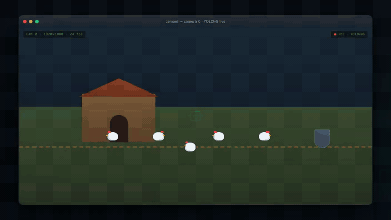
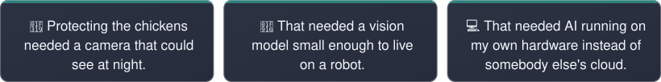
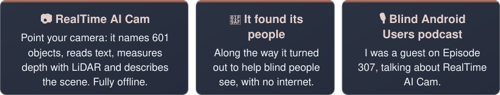
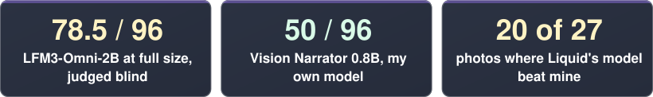
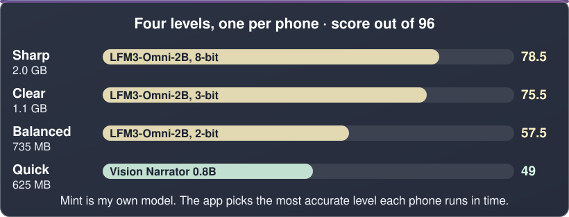
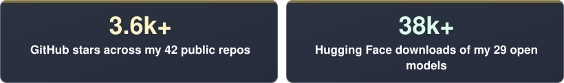
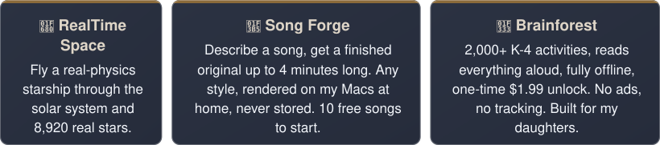
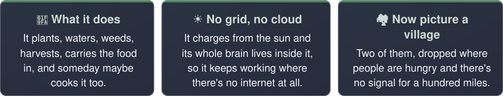
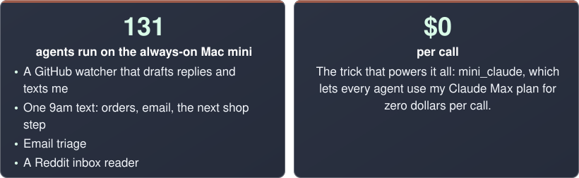

<picture><source media="(max-width: 610px), (min-width: 768px) and (max-width: 895px)" srcset="https://raw.githubusercontent.com/nicedreamzapp/nicedreamzapp/a328a9beab67af18c7a84e4c8c71062b53429bc0/assets/profile/rows/hero-m.svg"><source media="(max-width: 1149px)" srcset="https://raw.githubusercontent.com/nicedreamzapp/nicedreamzapp/a328a9beab67af18c7a84e4c8c71062b53429bc0/assets/profile/rows/hero-mid.svg"></picture>

<picture><source media="(max-width: 610px), (min-width: 768px) and (max-width: 895px)" srcset="https://raw.githubusercontent.com/nicedreamzapp/nicedreamzapp/a328a9beab67af18c7a84e4c8c71062b53429bc0/assets/profile/rows/s01-banner-m.svg"><source media="(max-width: 1149px)" srcset="https://raw.githubusercontent.com/nicedreamzapp/nicedreamzapp/a328a9beab67af18c7a84e4c8c71062b53429bc0/assets/profile/rows/s01-banner-mid.svg"></picture>
<picture><source media="(max-width: 610px), (min-width: 768px) and (max-width: 895px)" srcset="https://raw.githubusercontent.com/nicedreamzapp/nicedreamzapp/a328a9beab67af18c7a84e4c8c71062b53429bc0/assets/profile/rows/s01-r1-m.svg"><source media="(max-width: 1149px)" srcset="https://raw.githubusercontent.com/nicedreamzapp/nicedreamzapp/a328a9beab67af18c7a84e4c8c71062b53429bc0/assets/profile/rows/s01-r1-mid.svg"></picture>

> Dozens of repos later I am somehow doing neuroscience, and every one of them still traces back to the coop.

🔗 [The neuroscience: a Parkinson's vulnerability predictor](https://github.com/nicedreamzapp/parkinsons-vulnerability-predictor)

<picture><source media="(max-width: 610px), (min-width: 768px) and (max-width: 895px)" srcset="https://raw.githubusercontent.com/nicedreamzapp/nicedreamzapp/a328a9beab67af18c7a84e4c8c71062b53429bc0/assets/profile/rows/s02-banner-m.svg"><source media="(max-width: 1149px)" srcset="https://raw.githubusercontent.com/nicedreamzapp/nicedreamzapp/a328a9beab67af18c7a84e4c8c71062b53429bc0/assets/profile/rows/s02-banner-mid.svg"></picture>
<picture><source media="(max-width: 610px), (min-width: 768px) and (max-width: 895px)" srcset="https://raw.githubusercontent.com/nicedreamzapp/nicedreamzapp/a328a9beab67af18c7a84e4c8c71062b53429bc0/assets/profile/rows/s02-r1-m.svg"><source media="(max-width: 1149px)" srcset="https://raw.githubusercontent.com/nicedreamzapp/nicedreamzapp/a328a9beab67af18c7a84e4c8c71062b53429bc0/assets/profile/rows/s02-r1-mid.svg"></picture>

👁️ **My own model, Vision Narrator 0.8B** · A LoRA fine-tune of Qwen3.5-0.8B on VizWiz photos taken by blind people (CC BY 4.0), taught by a 27B teacher. It was the app's first describer.

🔗 [App Store](https://apps.apple.com/us/app/id6751230739) · [Google Play](https://play.google.com/store/apps/details?id=com.mattmacosko.realtimeaicam) · [Source](https://github.com/nicedreamzapp/RealTimeAICam) · ▶ [Watch it see the world, fully offline (90 sec)](https://www.youtube.com/watch?v=2BEYv-fv-gE) · 🎙️ [Episode 307](https://youtu.be/VJ0atAEWl1g?t=871) · [Vision Narrator 0.8B on Hugging Face](https://huggingface.co/divinetribe/Vision-Narrator-0.8B-4bit-mlx)

<picture><source media="(max-width: 610px), (min-width: 768px) and (max-width: 895px)" srcset="https://raw.githubusercontent.com/nicedreamzapp/nicedreamzapp/a328a9beab67af18c7a84e4c8c71062b53429bc0/assets/profile/rows/s03-banner-m.svg"><source media="(max-width: 1149px)" srcset="https://raw.githubusercontent.com/nicedreamzapp/nicedreamzapp/a328a9beab67af18c7a84e4c8c71062b53429bc0/assets/profile/rows/s03-banner-mid.svg"></picture>
<picture><source media="(max-width: 610px), (min-width: 768px) and (max-width: 895px)" srcset="https://raw.githubusercontent.com/nicedreamzapp/nicedreamzapp/a328a9beab67af18c7a84e4c8c71062b53429bc0/assets/profile/rows/s03-r1-m.svg"><source media="(max-width: 1149px)" srcset="https://raw.githubusercontent.com/nicedreamzapp/nicedreamzapp/a328a9beab67af18c7a84e4c8c71062b53429bc0/assets/profile/rows/s03-r1-mid.svg"></picture>

📋 **The test** · 27 photos of what blind users point a phone at: medicine labels, money, curbs, stairs, signs, a dark street. Every answer was shuffled and judged with the model names hidden, and every safety miss cost 2 points. Best possible score: 96.

🏆 **The result** · Liquid AI's LFM3-Omni-2B beat my own Vision Narrator 0.8B on 20 of 27 photos, with 1 safety miss to my model's 5. So Liquid's model is what RealTime AI Cam ships now.

🔬 **The surprise** · I fine-tuned Liquid's model on my blind-user data and it got worse, 17.5 points worse at 1.1 GB. It ships exactly as Liquid released it.

📦 **Shrinking it for phones** · I quantized it myself, from 2 GB down. From 870 MB down the scores drop fast, and by 640 MB both 2B models fell apart, so 735 MB is the smallest that held up.

🔍 **The detector rematch** · In a fair rematch on 150 photos, YOLOE-26 with 4,585 words lost to the app's 601-object detector: lower recall (0.15 vs 0.23), about 3x slower, and 48% of its confident labels outside the 601 were made up. The 601 detector kept its job.

📱 **In the apps now** · iPhone 1.4.0 and Android 1.28 both pick from the four levels on their own.

🎯 **How it picks** · Both apps pick the most accurate level each phone can run in time.

<picture><source media="(max-width: 610px), (min-width: 768px) and (max-width: 895px)" srcset="https://raw.githubusercontent.com/nicedreamzapp/nicedreamzapp/a328a9beab67af18c7a84e4c8c71062b53429bc0/assets/profile/rows/s02-levels-m.svg"><source media="(max-width: 1149px)" srcset="https://raw.githubusercontent.com/nicedreamzapp/nicedreamzapp/a328a9beab67af18c7a84e4c8c71062b53429bc0/assets/profile/rows/s02-levels-mid.svg"></picture>

📊 [The full benchmark, every round and every number](https://github.com/nicedreamzapp/RealTimeAICam/tree/main/benchmarks)

<picture><source media="(max-width: 610px), (min-width: 768px) and (max-width: 895px)" srcset="https://raw.githubusercontent.com/nicedreamzapp/nicedreamzapp/a328a9beab67af18c7a84e4c8c71062b53429bc0/assets/profile/rows/s04-banner-m.svg"><source media="(max-width: 1149px)" srcset="https://raw.githubusercontent.com/nicedreamzapp/nicedreamzapp/a328a9beab67af18c7a84e4c8c71062b53429bc0/assets/profile/rows/s04-banner-mid.svg"></picture>
<picture><source media="(max-width: 610px), (min-width: 768px) and (max-width: 895px)" srcset="https://raw.githubusercontent.com/nicedreamzapp/nicedreamzapp/a328a9beab67af18c7a84e4c8c71062b53429bc0/assets/profile/rows/s04-r1-m.svg"><source media="(max-width: 1149px)" srcset="https://raw.githubusercontent.com/nicedreamzapp/nicedreamzapp/a328a9beab67af18c7a84e4c8c71062b53429bc0/assets/profile/rows/s04-r1-mid.svg"></picture>

🧩 **lfm-tool-calls** · A parser and OpenAI compatible proxy that turns Liquid AI LFM tool calls into standard ones.

🌐 **Browser Agent** · Local MLX models driving Chrome via DevTools Protocol. Handles cross-origin iframes, Shadow DOM and ProseMirror.

🗣️ **NarrateClaude + Ohm** · Talk to your Mac, hear it reply in your own cloned voice. 100% private, works on a plane.

👁️ **nemotron-omni-mlx** · NVIDIA's Nemotron Omni had no open Apple Silicon runtime for its vision and audio towers, so I wrote one: 23/23 parity tests against NVIDIA's PyTorch reference, 67.7 tok/s with an image and 110.5 tok/s with audio on an M5 Max.

🍎 **Upstream in Apple's MLX** · Muse Glimmer (Meta) text model support merged into ml-explore/mlx-lm (+302 lines). Thanks to @zcbenz for the review and merge.

🖥️ **Trinidad Head** · My own terminal for Windows and Mac: glass windows with a neon glow, a different color for every window, your own questions easy to spot in an AI chat.

<picture><source media="(max-width: 610px), (min-width: 768px) and (max-width: 895px)" srcset="https://raw.githubusercontent.com/nicedreamzapp/nicedreamzapp/a328a9beab67af18c7a84e4c8c71062b53429bc0/assets/profile/rows/s-lately-r1-m.svg"><source media="(max-width: 1149px)" srcset="https://raw.githubusercontent.com/nicedreamzapp/nicedreamzapp/a328a9beab67af18c7a84e4c8c71062b53429bc0/assets/profile/rows/s-lately-r1-mid.svg"></picture>

**Building lately** (the week of Nov 9, numbers as of Nov 10, 2026)

🔨 **[browser-agent](https://github.com/nicedreamzapp/browser-agent)** · The browser agent now leases a separate virtual Mac instead of my screen, and pauses it when nobody is using it.

🔨 **[Heat-N-Clean-Glass-Oven](https://github.com/nicedreamzapp/Heat-N-Clean-Glass-Oven)** · Shrank the oven 8 mm so the glass slurper fits the top cap, and added 48 vent holes to the lid ceramic holder.

🔨 **[NarrateClaude](https://github.com/nicedreamzapp/NarrateClaude)** · Released NarrateClaude 2.0.0 with barge in, so you can talk over the voice to stop it.

🔨 **[moonstone](https://github.com/nicedreamzapp/moonstone)** · Moonstone got a model picker, accounts with Auto, a usage bar, finish time estimates and tap answers.

🔨 **[story-forge](https://github.com/nicedreamzapp/story-forge)** · Story Forge now prints a per part time estimate before every shot run.

🔗 [claude-code-local](https://github.com/nicedreamzapp/claude-code-local): **<!--CCL:START-->3,400+ stars, 648 forks<!--CCL:END-->** · [Awesome Claude Code](https://github.com/hesreallyhim/awesome-claude-code) · [Browser Broker](https://github.com/nicedreamzapp/browser-broker) · [Browser Agent](https://github.com/nicedreamzapp/browser-agent) (▶ [56-second demo](https://youtu.be/SIuMNa2k6Wc)) · [NarrateClaude + Ohm](https://github.com/nicedreamzapp/NarrateClaude) · [nemotron-omni-mlx](https://github.com/nicedreamzapp/nemotron-omni-mlx) · [MLX pull request](https://github.com/ml-explore/mlx-lm/pull/1710) · [@zcbenz](https://github.com/zcbenz) · [Agent-12](https://nicedreamzapp.github.io/agent12/) · [@galashko](https://github.com/galashko) · [lfm-tool-calls](https://github.com/nicedreamzapp/lfm-tool-calls) · [Trinidad Head](https://github.com/nicedreamzapp/trinidad-head)

<picture><source media="(max-width: 610px), (min-width: 768px) and (max-width: 895px)" srcset="https://raw.githubusercontent.com/nicedreamzapp/nicedreamzapp/a328a9beab67af18c7a84e4c8c71062b53429bc0/assets/profile/rows/s05-banner-m.svg"><source media="(max-width: 1149px)" srcset="https://raw.githubusercontent.com/nicedreamzapp/nicedreamzapp/a328a9beab67af18c7a84e4c8c71062b53429bc0/assets/profile/rows/s05-banner-mid.svg"></picture>
<picture><source media="(max-width: 610px), (min-width: 768px) and (max-width: 895px)" srcset="https://raw.githubusercontent.com/nicedreamzapp/nicedreamzapp/a328a9beab67af18c7a84e4c8c71062b53429bc0/assets/profile/rows/s05-r1-m.svg"><source media="(max-width: 1149px)" srcset="https://raw.githubusercontent.com/nicedreamzapp/nicedreamzapp/a328a9beab67af18c7a84e4c8c71062b53429bc0/assets/profile/rows/s05-r1-mid.svg"></picture>

🐝 **Hive Strike** · One bee against sixteen worlds, sixteen bosses and seventy-five kinds of bug. Every sprite, background, animated scene and music bed generated locally on one Mac, no cloud, no stock art.

> 📱 **Every app, both stores.** All 5 are live on the App Store and Google Play. Private by default, pay once (or nothing), no subscriptions. Android source ships in each repo's android/ folder.

📱 <!--APPS-LINE:START-->5 apps on the App Store and Google Play, **2,898 downloads** so far (1,998 App Store, 900 Google Play), 71 new on iPhone in the last week.<!--APPS-LINE:END-->

🍎 **App Store:** [Song Forge](https://apps.apple.com/us/app/id6788616929) · [RealTime AI Cam](https://apps.apple.com/us/app/id6751230739) · [RealTime Space](https://apps.apple.com/us/app/id6788646103) · [Brainforest](https://apps.apple.com/us/app/id6788301765) · [Hive Strike](https://apps.apple.com/us/app/id6808332314) 
🤖 **Google Play:** [Song Forge](https://play.google.com/store/apps/details?id=com.nicedreamz.ownatune) · [RealTime AI Cam](https://play.google.com/store/apps/details?id=com.mattmacosko.realtimeaicam) · [RealTime Space](https://play.google.com/store/apps/details?id=com.nicedreamz.realtimespace) · [Brainforest](https://play.google.com/store/apps/details?id=com.brainforest.app) · [Hive Strike](https://play.google.com/store/apps/details?id=com.nicedreamz.hivestrike)

<!--APP-STATS:START-->
> _Updated automatically **Nov 10, 2026** from Apple's sales reports and Google Play's install reports. Downloads are first-time App Store downloads (no updates or re-downloads) plus Google Play installs; Google runs about two weeks behind._

| App | Live since | Downloads | App Store | Google Play | New on iPhone, last 7 days | App Store rating |
|---|---|---:|---:|---:|---:|:---:|
| **RealTime AI Cam** | Aug 2025 | **1,973** | 1,357 | 616 | 41 | ★ 5.0 (3) |
| **Song Forge** | Jul 2026 | **410** | 205 | 205 | 8 | – |
| **RealTime Space** | Jul 2026 | **403** | 341 | 62 | 18 | – |
| **Brainforest** | Jul 2026 | **98** | 88 | 10 | 3 | ★ 5.0 (1) |
| **Hive Strike** | Sep 2026 | **14** | 7 | 7 | 1 | – |
| **Total** | | **2,898** | **1,998** | **900** | **71** | |

**New iPhone downloads per week, last 8 weeks:** 117 → 65 → 157 → 85 → 49 → 51 → 49 → 71 (+22 vs the week before).
<!--APP-STATS:END-->

<picture><source media="(max-width: 610px), (min-width: 768px) and (max-width: 895px)" srcset="https://raw.githubusercontent.com/nicedreamzapp/nicedreamzapp/a328a9beab67af18c7a84e4c8c71062b53429bc0/assets/profile/rows/s06-banner-m.svg"><source media="(max-width: 1149px)" srcset="https://raw.githubusercontent.com/nicedreamzapp/nicedreamzapp/a328a9beab67af18c7a84e4c8c71062b53429bc0/assets/profile/rows/s06-banner-mid.svg"></picture>
<picture><source media="(max-width: 610px), (min-width: 768px) and (max-width: 895px)" srcset="https://raw.githubusercontent.com/nicedreamzapp/nicedreamzapp/a328a9beab67af18c7a84e4c8c71062b53429bc0/assets/profile/rows/s06-r1-m.svg"><source media="(max-width: 1149px)" srcset="https://raw.githubusercontent.com/nicedreamzapp/nicedreamzapp/a328a9beab67af18c7a84e4c8c71062b53429bc0/assets/profile/rows/s06-r1-mid.svg"></picture>

> 🌱 **Here's where all of this is headed.** You hand a robot a bag of seeds, show it where the hose is, and a few months later there are vegetables on the table.

**RealTime AI Cam is the eyes**

**Claude Code Local is the brain** · The brain without a cloud.

**The Cemani robot is the first body** · A 1 kW autonomous tank robot you text from your phone: vision on a Jetson, dual PTZ cameras, 3D LIDAR, and it pulls a cart of firewood.

🧩 **One system, three machines** · M5 Max MacBook Pro · 128 GB for heavy compute, an M4 Pro Mac mini · 64 GB that never sleeps (131 background jobs: watchers, servers, tunnels), and a Contabo VPS as the public gateway.

🔒 **AirGap** · The same stack runs with the wifi off, for firms whose data cannot touch the cloud.

🔗 [Cemani Homestead Robot](https://github.com/nicedreamzapp/CemaniHomesteadRobot) · ▶ [53-second demo](https://youtu.be/NWnGvvdvRik) · [VisionBuilder](https://github.com/nicedreamzapp/VisionBuilder) · [AirGap](https://nicedreamzwholesale.com/airgap/) · [info@nicedreamzwholesale.com](mailto:info@nicedreamzwholesale.com)

<picture><source media="(max-width: 610px), (min-width: 768px) and (max-width: 895px)" srcset="https://raw.githubusercontent.com/nicedreamzapp/nicedreamzapp/a328a9beab67af18c7a84e4c8c71062b53429bc0/assets/profile/rows/s07-banner-m.svg"><source media="(max-width: 1149px)" srcset="https://raw.githubusercontent.com/nicedreamzapp/nicedreamzapp/a328a9beab67af18c7a84e4c8c71062b53429bc0/assets/profile/rows/s07-banner-mid.svg"></picture>
<picture><source media="(max-width: 610px), (min-width: 768px) and (max-width: 895px)" srcset="https://raw.githubusercontent.com/nicedreamzapp/nicedreamzapp/a328a9beab67af18c7a84e4c8c71062b53429bc0/assets/profile/rows/s07-r1-m.svg"><source media="(max-width: 1149px)" srcset="https://raw.githubusercontent.com/nicedreamzapp/nicedreamzapp/a328a9beab67af18c7a84e4c8c71062b53429bc0/assets/profile/rows/s07-r1-mid.svg"></picture>

🛒 **What pays the bills** · Divine Tribe, vaporizer hardware since 2013, plus three more stores.

📬 **[matt@ineedhemp.com](mailto:matt@ineedhemp.com)** · 📚 **[Case studies](https://nicedreamzwholesale.com/software/case-studies/)** · [HQ](https://github.com/nicedreamzapp/how-my-shop-runs) · [Divine Tribe](https://ineedhemp.com) · [three more stores](https://marijuanaunion.com) · [LinkedIn](https://www.linkedin.com/in/matt-macosko-34708235/)

Built with code and caffeine · Humboldt County, CA · the chickens are fine

